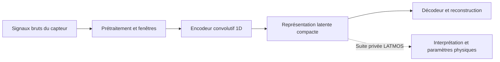
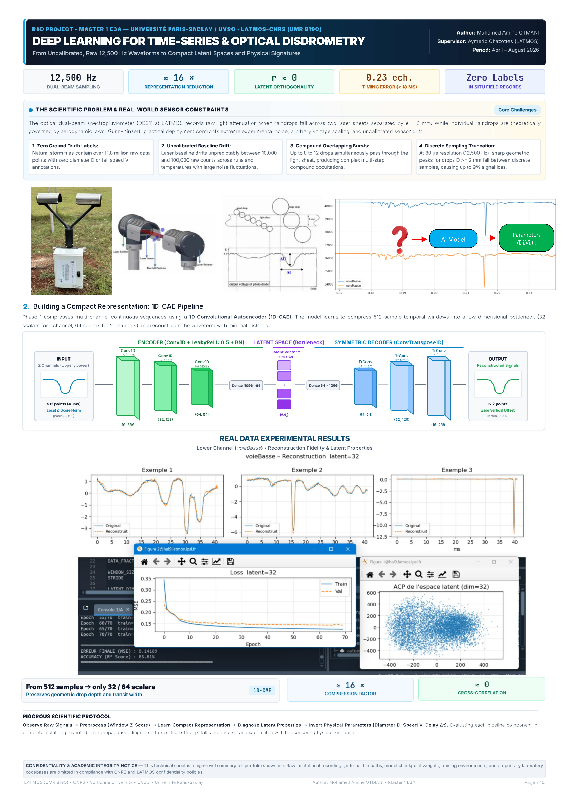
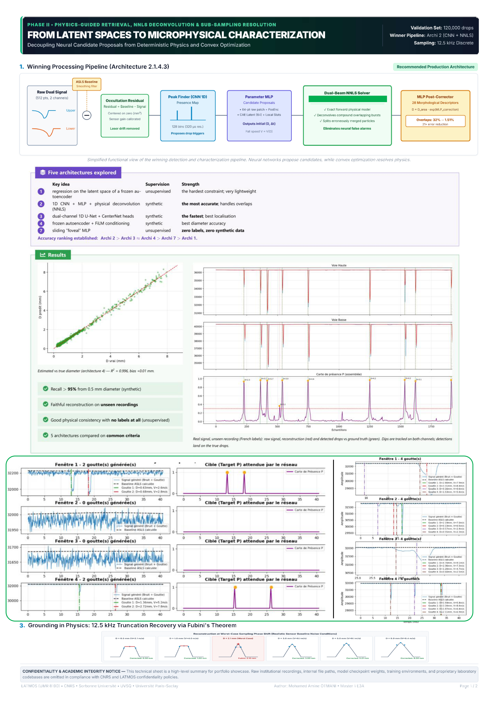

# Autoencodeurs pour la disdrométrie optique

**Réduire les données d'environ ×15 en conservant autant que possible l'information utile des signaux.**

Projet de recherche de **Mohamed Amine OTMANI**, réalisé au **LATMOS**, dans le cadre du Master 1 E3A — Université Paris-Saclay / UVSQ. Les affiches fournies présentent la période avril–août 2026 et un encadrement par Aymeric Chazottes.

> **Présentation publique partielle.** Le dépôt original complet, les informations internes et la continuité du développement sont **privés et réservés au laboratoire LATMOS**. Toute réutilisation est soumise aux [conditions d'autorisation](LICENSE.md).

## Objectif scientifique

Un autoencodeur convolutif 1D apprend sans étiquettes à encoder une fenêtre temporelle de signal dans un espace latent compact, puis à reconstruire ce signal. L'objectif est une représentation environ **15 fois plus petite**, avec une perte d'information limitée.

Les configurations à latent 32 pour une voie, ou latent 64 pour deux voies, donnent une **réduction dimensionnelle théorique de ×16** :

| Configuration | Valeurs en entrée par fenêtre | Valeurs latentes | Rapport |
| --- | ---: | ---: | ---: |
| Une voie, latent 32 | 512 | 32 | ×16 |
| Deux voies, latent 64 | 2 × 512 = 1 024 | 64 | ×16 |

Ce rapport compte les valeurs numériques ; il ne mesure pas directement la taille des fichiers. Le stockage réel dépend de la précision numérique, du recouvrement des fenêtres, du format et des paramètres de normalisation à conserver. La compression est **avec perte** : le rapport dimensionnel ne garantit pas à lui seul la conservation de toute l'information physique.

## Du signal brut à l'information physique

Les signaux proviennent d'un disdromètre optique à deux voies mesurant l'atténuation lumineuse au passage des gouttes. Les affiches indiquent une acquisition à **12 500 Hz**, soit un pas de 80 µs. Une fenêtre de 512 échantillons couvre environ 41 ms.

La première étape construit une représentation compacte des signaux bruts non étiquetés. La continuité privée vise à convertir ces signaux, difficiles à interpréter directement, en **informations physiques utiles**, en reliant **physique, électronique et intelligence artificielle** : caractérisation des gouttes, diamètre, vitesse et décalage temporel entre les voies.



## Présentation visuelle

Les deux affiches ont été fournies par l'auteur pour cette présentation publique. Les résultats qui y figurent sont ceux rapportés sur ces supports ; aucune nouvelle évaluation n'a été exécutée lors de la réorganisation du dépôt.

### Phase 1 — Représentation compacte et reconstruction

[](docs/images/phase-1-autoencoder.jpg)

### Phase 2 — Aperçu de la continuité privée

Cette synthèse présente la restitution guidée par la physique et la caractérisation microphysique. Les architectures et outils correspondants ne sont pas distribués ici.

[](docs/images/phase-2-physical-retrieval.jpg)

Consulter aussi la [fiche de présentation en français](docs/Fiche_Amine_Otmani_FR.pdf).

## Organisation du dépôt

```text
.
├── README.md
├── LICENSE.md
├── requirements.txt
├── .gitignore
├── scripts/
│   ├── autoencoder_1ch_global.py
│   ├── autoencoder_1ch_window.py
│   └── autoencoder_2ch.py
├── models/
│   └── best_AE_1805_2V_2026-05-19_15-43-24.pth
└── docs/
    ├── Fiche_Amine_Otmani_FR.pdf
    └── images/
        ├── phase-1-autoencoder.jpg
        └── phase-2-physical-retrieval.jpg
```

Les scripts ont été renommés pour faciliter la navigation ; leur contenu expérimental est conservé. Le checkpoint historique déjà public est rangé dans `models/` ; sa présence n'accorde aucun droit de réutilisation ni accès aux modèles privés.

## Variantes disponibles

| Script | Entrée effectivement utilisée | Normalisation | Dimension latente configurée |
| --- | --- | --- | ---: |
| `scripts/autoencoder_1ch_global.py` | `voieBasse` | Z-score global | 32 |
| `scripts/autoencoder_1ch_window.py` | `voieHaute` dans le code actuel | Globale puis par fenêtre | 16 |
| `scripts/autoencoder_2ch.py` | `voieHaute` et `voieBasse` | Globale puis par fenêtre et par voie | 64 |

La variante par fenêtre est actuellement réglée sur 16 dimensions, soit ×32 en nombre de valeurs pour une voie. Les exemples à latent 32 de l'affiche correspondent à une autre configuration expérimentale. Certains commentaires historiques ne reflètent pas tous les paramètres actifs.

Les modèles associent des couches `Conv1d`, un goulot latent dense et un décodeur `ConvTranspose1d`. Les scripts incluent l'entraînement, des métriques MSE/R², des reconstructions et des visualisations de l'espace latent.

## Prérequis et exécution dans un environnement autorisé

Ces scripts de recherche ne constituent pas un paquet autonome. Ils nécessitent les enregistrements instrumentaux et le lecteur interne `pydata`, absents de ce dépôt. Installer les dépendances publiques ne suffit donc pas à reproduire les expériences.

Après obtention des autorisations et des ressources nécessaires :

1. Créer un environnement Python et installer les dépendances publiques :

   ```bash
   python -m venv .venv
   # Activer l'environnement selon votre système.
   python -m pip install -r requirements.txt
   ```

2. Rendre le paquet interne `pydata` importable et placer les données autorisées dans `bin/` à la racine. Ces ressources locales sont exclues par `.gitignore`.
3. Adapter `FICHIER`, la voie sélectionnée et les hyperparamètres dans le script choisi.
4. Lancer depuis la **racine du dépôt**, par exemple :

   ```bash
   python scripts/autoencoder_2ch.py
   ```

Les versions exactes de l'environnement d'origine ne sont pas documentées : `requirements.txt` est une liste de dépendances, sans garantie de compatibilité avec toutes leurs versions. La variante par fenêtre contient un import historique de `curses`, et certains scripts utilisent l'argument `verbose` du scheduler PyTorch ; des adaptations peuvent être nécessaires selon l'environnement. Aucun entraînement n'a été relancé pour cette réorganisation.

## Lecture des résultats et limites

- La MSE et le R² évaluent la reconstruction du signal normalisé ; ils ne suffisent pas à valider une restitution de diamètre ou de vitesse.
- Les scripts utilisent des fenêtres de 512 points avec un pas de 256. Leur séparation aléatoire entre entraînement, validation et test peut placer des fenêtres voisines et recouvrantes dans plusieurs ensembles. Une validation indépendante doit séparer les enregistrements ou blocs temporels avant fenêtrage.
- Reconstruire les amplitudes physiques après un Z-score nécessite de conserver les paramètres de normalisation correspondants ; les seuls vecteurs latents ne suffisent pas.
- Reproduire intégralement les résultats des affiches nécessite les ressources et protocoles privés du laboratoire.

## Confidentialité, autorisation et contact

Le dépôt original complet et la suite du projet restent privés et réservés au **LATMOS**. Aucune donnée brute ni ressource interne supplémentaire n'est fournie avec cette présentation.

**Une autorisation écrite préalable est requise pour toute utilisation ou réutilisation, ainsi que pour les forks au-delà des droits accordés par GitHub et par la loi.** Un dépôt public sur GitHub reste consultable et forkable au sein du service selon ses conditions. Voir [LICENSE.md](LICENSE.md) pour le périmètre exact.

Pour toute demande, contacter [Mohamed Amine OTMANI sur GitHub](https://github.com/otmaniamine). Les accords des titulaires des droits concernés, notamment du laboratoire lorsque nécessaire, doivent être obtenus avant réutilisation.
